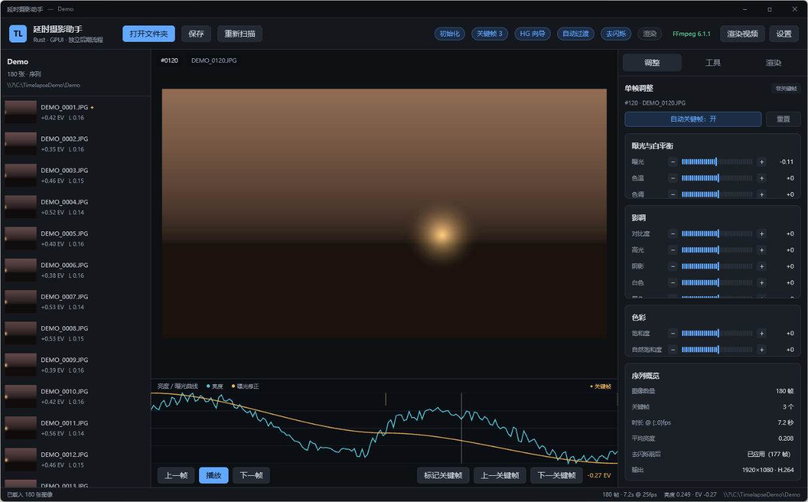

# Timelapse Assistant

A standalone timelapse post-production suite built with **Rust + GPUI**. It combines sequence analysis, keyframe grading, exposure transitions, visual deflicker, XMP sidecars and video rendering in one desktop application — no external editor or Java runtime required.




## Features

- **Sequence import** for JPEG / PNG / TIFF / DNG / CR2 / CR3 / NEF / ARW / RAF / ORF / RW2, with EXIF parsing and natural or capture-time ordering.
- **RAW handling**: embedded JPEG previews for fast thumbnails and analysis; supported raw files are demosaiced with pure-Rust `rawler`, with automatic fallback to the embedded preview.
- **Keyframes**: mark/unmark, previous/next keyframe, first/last shortcuts, automatic keyframing while editing.
- **Holy Grail wizard**: compensates exposure/brightness steps during day-to-night shoots. Offset, stretch, rotate and initial smoothing controls, plus a 351-evaluation auto-optimizer.
- **Auto transition**: linear or smooth interpolation of exposure, temperature, tint, contrast, highlights, shadows, whites, blacks, saturation and vibrance between keyframes.
- **Visual deflicker**: renders graded thumbnails, measures luminance, applies LOESS smoothing and writes EV corrections. Accuracy, smoothing, multi-pass and constant modes.
- **XMP sidecars**: Adobe Camera Raw compatible `crs:*` fields plus this project's workflow markers; unrelated metadata in existing sidecars is preserved.
- **Rendering**: parallel frame rendering, 1080p/4K/vertical, 24/25/30/60 fps, H.264/H.265/ProRes. Advanced export supports CRF quality mode or target bitrate (VBR), fast/balanced/high-quality encoder presets, motion blur, sharpening and optional frame export.
- **Managed FFmpeg**: first launch imports a system FFmpeg or downloads a fast mirror build; Settings can download the latest build, install from an archive, switch and uninstall versions.
- **Dark chrome**: custom titlebar with native window controls (minimize/maximize/close).
- **Project persistence**: `.lrtassist/project.json` and thumbnail cache under `.lrtassist/thumbs`.
- **Headless CLI** (`tlcore`) for batch processing, automated tests and CI rendering.

## Quick start

Prebuilt binaries are in `dist/`:

- `dist/timelapse_assistant.exe` — desktop app
- `dist/tlcore.exe` — batch CLI
- `dist/components/` — automatically installed FFmpeg components

Requirements:

- Windows 10/11
- Stable Rust (when building from source)
- FFmpeg is optional; the app imports a system build or downloads one on first launch

Build from source:

```bash
cargo build --release
```

Open the app, optionally with a sequence folder:

```bash
target/release/timelapse_assistant.exe "D:/photos/my-timelapse"
```

Run the full pipeline on a synthetic sequence:

```bash
target/release/tlcore.exe demo ./.demo
target/release/tlcore.exe analyze ./.demo
target/release/tlcore.exe hg ./.demo
target/release/tlcore.exe keyframes ./.demo
target/release/tlcore.exe transition ./.demo
target/release/tlcore.exe deflicker ./.demo
target/release/tlcore.exe xmp ./.demo
target/release/tlcore.exe render ./.demo ./out.mp4
```

## Recommended workflow

1. **Open a folder**: every frame is analyzed and thumbnailed.
2. **Mark keyframes**: editing a slider auto-marks the current frame unless disabled.
3. **Holy Grail wizard**: auto-optimize or apply manual parameters to flatten camera exposure steps.
4. **Grade keyframes**: set exposure, temperature, contrast and other creative parameters at the first and last keyframes.
5. **Auto transition**: interpolate all creative columns between keyframes.
6. **Visual deflicker**: render graded previews, measure luminance, apply LOESS and write EV corrections; optionally multiple passes.
7. **Render**: choose resolution, fps, codec and rate control; XMP sidecars are written automatically unless disabled.
8. **Deliver**: export MP4/MOV or use the XMP sidecars in another XMP-aware application.

## UI

- **Top bar**: open folder, save, rescan, workflow status, FFmpeg status, render, settings.
- **Left panel**: sequence list with thumbnails, exposure correction, luminance and keyframe markers.
- **Center**: preview, luminance/exposure curves, keyframe markers, playback and frame navigation.
- **Right panel**: Adjust, Tools and Render pages; Settings opens from the top bar.
- **Settings**: install, import, switch and uninstall FFmpeg components.

## FFmpeg components

Components live next to the executable in `components/ffmpeg/`. If the install directory is read-only, the app falls back to:

```text
%LOCALAPPDATA%\TimelapseAssistant\components
```

Each version is stored in `components/ffmpeg/<version>/` with `ffmpeg.exe`, `ffprobe.exe` and sibling DLLs. `versions.json` tracks the selected version, installed versions and first-run state.

First launch:

1. Import a system FFmpeg from `PATH` or common install directories when available.
2. Otherwise install FFmpeg 4.1.0 from a fast mirror.
3. Fall back to the latest official essentials build if the mirror fails.
4. Settings can download the latest build, install from ZIP/TGZ, import a system copy, switch, uninstall or fall back to system FFmpeg.

## CLI

```text
tlcore demo <folder>         create a synthetic test sequence
tlcore analyze <folder>      import, EXIF, thumbnails and luminance analysis
tlcore hg <folder>           apply the Holy Grail wizard with saved settings
tlcore hgopt <folder>        auto-search stretch/rotate
tlcore keyframes <folder>    mark first/middle/last keyframes (testing)
tlcore transition <folder>   auto-transition between keyframes
tlcore deflicker <folder>    visual-preview deflicker
tlcore report <folder>       print flicker score and exposure range
tlcore xmp <folder>          write XMP sidecars
tlcore render <folder> [out] render and encode
tlcore ffmpeg-status         show the active component and installed versions
tlcore ffmpeg-import         import the system FFmpeg
tlcore ffmpeg-install        fast mirror install
tlcore ffmpeg-install-latest download the latest official build
tlcore ffmpeg-use <version>  switch managed version
tlcore ffmpeg-system         fall back to system FFmpeg
tlcore ffmpeg-uninstall <v>  uninstall a managed version
```

## Layout

```text
src/
  main.rs                 GPUI desktop entry point
  lib.rs
  core/
    model.rs              sequence, adjustments, settings and project persistence
    analysis.rs           scanning, EXIF, preview/RAW decoding, thumbnails, visual luma
    loess.rs              tricube local linear regression (LOESS)
    deflicker.rs          visual deflicker
    holy_grail.rs         exposure curve and auto-optimizer
    transition.rs         keyframe interpolation
    xmp.rs                XMP sidecar read/write
    ffmpeg.rs             FFmpeg component install and version management
    image_pipeline.rs     exposure, white balance, tone and color
    render.rs             parallel rendering and ffmpeg encoding
  ui/
    app.rs                GPUI main window
    graph.rs              luminance/exposure graph
  bin/tlcore.rs           headless CLI
docs/
  用户手册.md
  算法设计.md
  开发指南.md
```

## Data layout

Per sequence folder:

```text
.lrtassist/
  project.json            adjustments, keyframes, render settings, workflow state
  thumbs/                 640px thumbnail cache
  render/frames/          temporary render frames (cleaned after encoding)
  exported_frames/        frames when "keep output frames" is enabled
```

The video output path can be changed on the Render page. By default videos are written to the sequence folder with a timestamped name.

## Known limits

- The tone pipeline is a compact in-house implementation, not a full commercial color engine.
- Visual deflicker analyzes 640px thumbnails rather than full-resolution previews; local extreme adjustments can differ.
- RAW decoding depends on `rawler` camera support; unsupported compression falls back to the embedded JPEG preview.
- No external catalog sync, HDR merge, local masks, lens correction, stabilization or advanced motion blur yet.
- Target bitrate is a VBR average and may undershoot on simple footage; use CRF when an exact rate is not required.
- The fast mirror installs FFmpeg 4.1.0. Use Settings to download a newer build when needed.

## Documentation

- [User guide (Chinese)](docs/用户手册.md): UI, workflow, rendering and FAQ.
- [Algorithm design (Chinese)](docs/算法设计.md): LOESS, deflicker, exposure transitions and rendering.
- [Development guide (Chinese)](docs/开发指南.md): modules, data flow, build, test and release.

## Third-party dependencies

- [GPUI](https://github.com/zed-industries/zed) — desktop UI framework
- [image](https://github.com/image-rs/image) — image codecs
- [rawler](https://github.com/dnglab/dnglab) — RAW decoding
- [rayon](https://github.com/rayon-rs/rayon) — data parallelism
- [FFmpeg](https://ffmpeg.org/) — video encoding, installed at runtime, under its own license

Refer to each project and the versions pinned in `Cargo.lock` for exact license terms.
