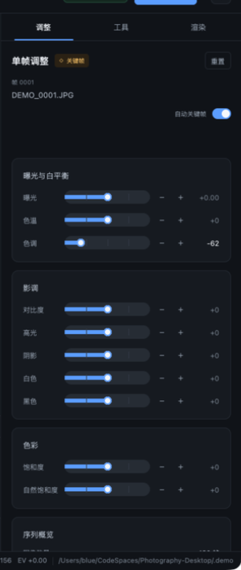

# 4. Per-frame adjustments

**English** · [简体中文](../zh/04-adjustments.md) · [Documentation home](README.md)

The **Adjust** tab edits exposure, white balance and tone for the **current frame**. Every frame owns ten creative parameters plus one EV correction written by the deflicker engine. Auto transition can connect these values into a smooth curve between keyframes.



## 4.1 Parameters

| Parameter | Range | Step | Default | Notes |
|-----------|-------|------|---------|-------|
| Exposure | −5.00 … +5.00 EV | 0.05 | 0 | Creative exposure compensation |
| Temperature | −100 … +100 | 1 | 0 | Relative white-balance shift, warm / cool |
| Tint | −100 … +100 | 1 | 0 | Green / magenta shift |
| Contrast | −100 … +100 | 1 | 0 | Tonal contrast |
| Highlights | −100 … +100 | 1 | 0 | Highlight region |
| Shadows | −100 … +100 | 1 | 0 | Shadow region |
| Whites | −100 … +100 | 1 | 0 | White point |
| Blacks | −100 … +100 | 1 | 0 | Black point |
| Saturation | −100 … +100 | 1 | 0 | Global saturation |
| Vibrance | −100 … +100 | 1 | 0 | Weighted toward low-saturation areas |
| Deflicker | Written by Tools | — | 0 | Read-only per-frame EV correction; not edited here |

The UI is split into three cards:

1. **Exposure & white balance**: exposure, temperature, tint;
2. **Tone**: contrast, highlights, shadows, whites, blacks;
3. **Colour**: saturation, vibrance.

## 4.2 Interaction

### Sliders

Each parameter track has 48 segments:

- **Click a segment**: jump to the value represented by that segment. Tick marks sit at 25% / 50% / 75%, and a white round handle shows the current position;
- **`−` / `+` buttons**: fine-step by the step size, clamped to the range;
- The value on the right updates live. Exposure uses two decimals (`+0.35`); all others use integers (`+12`);
- Modified parameters are bright; unmodified ones are grey.

> Because the track has only 48 segments, a click lands on the value for that segment and may not fall exactly on the step grid. Use `−` / `+` for exact values.

### Reset

**Reset** restores the current frame's ten creative parameters (`exposure` through `vibrance`). It does **not** clear:

- The deflicker correction;
- The keyframe flag;
- Adjustments on other frames.

### Auto keyframe

**Auto keyframe** at the top-right of the Adjust tab is on by default. While on, any slider or stepper action marks the current frame as a keyframe. While off, edits affect only the current frame and leave its keyframe state unchanged.

Recommendations:

- Keep it on while grading the first and last frames to save manual marking;
- Turn it off when making small tweaks to middle frames, which would otherwise create too many keyframes.

## 4.3 EV and preview

### Total EV

The EV shown in the status bar, preview header and Sequence overview is:

```text
total EV = exposure + deflicker
```

- `exposure` is the creative exposure set here;
- `deflicker` is the per-frame correction written by **Visual deflicker**;
- The sum is what the preview and final render use.

### Preview refresh

Every edit triggers an asynchronous preview:

- The preview uses a 1400 px long-edge proxy, graded and encoded as JPEG;
- Rapid successive edits invalidate older requests, so the UI never falls back to an older image;
- Only the current frame is previewed; the whole sequence is not pre-rendered;
- During playback cached thumbnails/previews are used; stopping restores the high-quality preview.

### What the values mean

Adjustments are stored as floating-point values and share one tone-mapping path between preview and final render:

| Parameter | Meaning |
|-----------|---------|
| Exposure | EV; 1.0 doubles brightness |
| Temperature | UI-relative units; exported to XMP as `5500 + temperature × 20` Kelvin |
| Tint | Same direction as Camera Raw Tint |
| Contrast / highlights / shadows / whites / blacks | Tone-curve control strengths |
| Saturation / vibrance | Colour strength |

> Temperature is not an absolute Kelvin value. Only when temperature or tint is non-zero does XMP write `WhiteBalance="Custom"` with the computed temperature; otherwise it writes `As Shot`.

## 4.4 XMP mapping

Exporting XMP (Tools button, or automatically during render) writes the current frame into Camera Raw compatible fields:

| UI parameter | XMP field | Notes |
|--------------|-----------|-------|
| Exposure + deflicker | `crs:Exposure2012` | Total EV |
| Temperature | `crs:Temperature` | Only when Custom, `5500 + temperature × 20` |
| Tint | `crs:Tint` | Only when Custom |
| Contrast | `crs:Contrast2012` | |
| Highlights | `crs:Highlights2012` | |
| Shadows | `crs:Shadows2012` | |
| Whites | `crs:Whites2012` | |
| Blacks | `crs:Blacks2012` | |
| Saturation | `crs:Saturation` | |
| Vibrance | `crs:Vibrance` | |
| Keyframe | `lrt:Keyframe` | `True` / `False` |
| Deflicker | `lrt:Deflicker` | Separate per-frame correction |
| Raw exposure | `lrt:Exposure2012` | Creative exposure without deflicker |

See [CLI and file formats](08-cli-and-files.md) for the complete schema and preservation rules.

## 4.5 Suggested grading workflow

1. **Compensate before creating**: run Holy Grail first to remove exposure steps from capture;
2. **Set the look at both ends**: grade the first frame's exposure, temperature and tone, then the last frame;
3. **Mark keyframes**: with Auto keyframe on, the above edits already did this;
4. **Add middle anchors**: place keyframes at points where the light changes significantly;
5. **Apply transition**: choose smooth or linear on the Tools tab and click **Apply auto transition**;
6. **Deflicker**: run visual deflicker on the graded sequence;
7. **Inspect EV**: use the graph and status bar to confirm there are no spikes;
8. **Render**: choose output settings on the Render tab.

> Adjustments are written to the project file only. The original photos are never modified. Deleting `.lrtassist/` returns the sequence to its ungraded state.

## 4.6 Acceptance checks

- Clicking any slider updates the value on the right and the EV in the status bar;
- **Reset** returns all ten parameters to 0 while keyframe and deflicker values stay;
- With auto keyframe off, editing a middle frame does not change the keyframe count;
- Switching to another frame and back preserves values;
- Closing and reopening the project preserves values and keyframes;
- After exporting XMP, `crs:Exposure2012` equals `exposure + deflicker`.

---

[← Previous: Sequences and keyframes](03-sequences-and-keyframes.md) · [Next: Tools →](05-tools.md)
