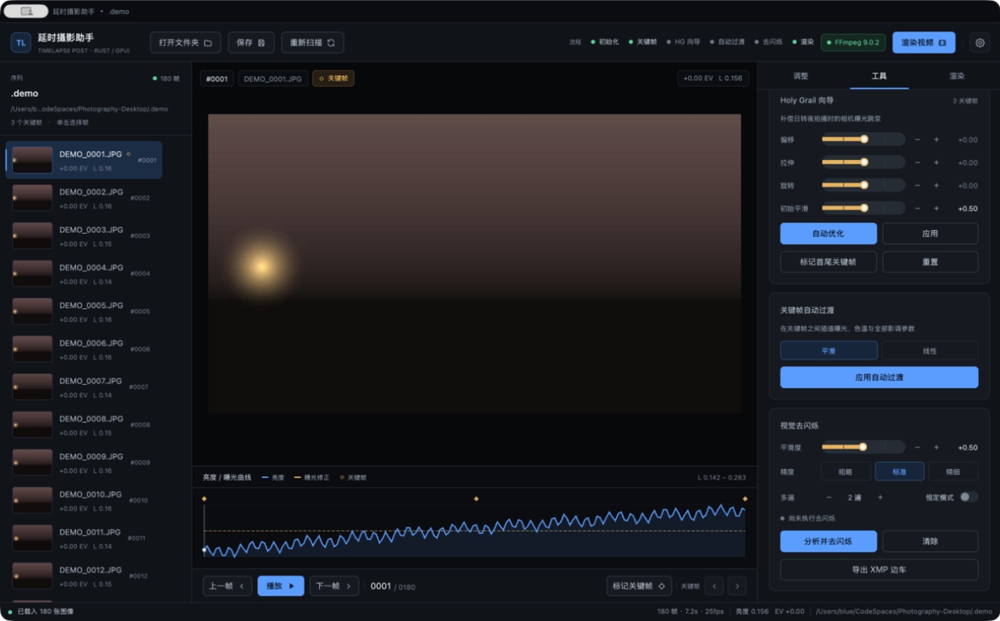
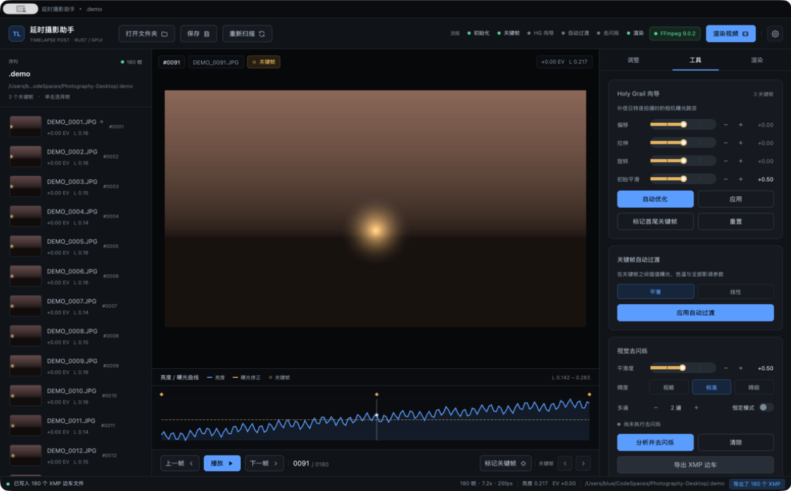

# 5. Tools: HG / transition / deflicker / XMP

**English** · [简体中文](../zh/05-tools.md) · [Documentation home](README.md)

The **Tools** tab contains four sequence-wide operations:

1. **Holy Grail wizard**: compensates camera exposure steps during day-to-night shoots;
2. **Keyframe auto transition**: interpolates all creative parameters between keyframes;
3. **Visual deflicker**: measures graded luminance and writes per-frame EV corrections;
4. **Export XMP sidecars**: writes Camera Raw compatible sidecars.



## 5.1 Holy Grail wizard


### Purpose

During a day-to-night shoot the camera keeps changing shutter, aperture or ISO, producing brightness steps. Holy Grail builds a compensation curve from EXIF exposure and image luminance, cancelling those steps while preserving the real sunset darkening.

### Parameters

| Parameter | Range | Step | Default | Purpose |
|-----------|-------|------|---------|---------|
| Offset | −5.00 … +5.00 | 0.05 | 0 | Lifts or lowers the whole compensation curve |
| Stretch | −1.50 … +1.50 | 0.02 | 0 | Scales the camera-exposure trend compensation |
| Rotate | −4.00 … +4.00 | 0.04 | 0 | Tilts the compensation linearly over time |
| Initial smoothing | 0.00 … 1.00 | 0.01 | 0.50 | LOESS smoothing applied to the raw exposure curve |

### Model

For each frame `i`, with normalised time `t = i / (n−1)` and the mean-removed camera EV series `trend`:

```text
ramp         = (t − 0.5) × rotate + offset
compensation = −trend × (1 + stretch) + ramp
exposure     = LOESS(compensation, initial smoothing)   // clamped to ±5 EV
```

White balance:

```text
jump        = wb − LOESS(wb, 0.45)
temperature = −jump × (0.35 + stretch × 0.15) + (t − 0.5) × rotate × 2
```

- `wb` is the gray-world white-balance proxy;
- The slow colour-temperature drift is kept while rapid jumps are cancelled;
- `tint` is fixed at 0.

### Optimize

**Optimize** runs a two-stage grid search:

| Stage | Range | Step | Evaluations |
|-------|-------|------|-------------|
| Stretch | −1.50 … +1.50 | 0.02 | 151 |
| Rotate | −4.00 … +4.00 | 0.04 | 201 |
| Total | | | 352 |

The score combines:

- Roughness of the adjusted luminance curve (mean absolute second difference);
- Mean absolute exposure correction (penalises large compensation);
- Mean absolute temperature correction (small weight).

For sequences longer than 600 frames the search runs on evenly spaced samples, then applies the chosen parameters to the full sequence to keep the button responsive.

> Optimize only changes **stretch** and **rotate**; offset and initial smoothing are left alone. Results are rounded to 0.01 before being written back.

### Steps

1. Import a sequence with usable EXIF (without EXIF the app falls back to luminance);
2. Optional: click **Mark first & last keyframes** to prepare transition anchors;
3. Click **Optimize** and wait for "Optimize complete" in the status bar;
4. Inspect the graph and preview, adjusting the four parameters by hand if needed;
5. Click **Apply** to write the compensation into every frame's `exposure` / `temperature` / `tint`;
6. If the result is unsatisfactory, click **Reset** to restore defaults (offset 0, stretch 0, rotate 0, initial smoothing 0.5) and apply again.

### Notes

- **Apply** overwrites the exposure, temperature and tint of **all** frames, including earlier creative edits;
- Keyframe flags are kept, but exposure values on keyframes are also overwritten;
- Optimize is synchronous; the UI may pause briefly on very long sequences;
- HG writes ordinary adjustment values, so you can still tweak them and re-run transition afterwards.

## 5.2 Keyframe auto transition


### Purpose

Interpolates keyframe adjustments into every frame between them, producing smooth exposure and colour ramps.

### Modes

| Mode | Formula | Character |
|------|---------|-----------|
| Smooth (default) | `u²(3 − 2u)` | Zero slope at keyframes; soft starts and ends |
| Linear | `u` | Constant rate; corners at keyframes |

Here `u = (i − a) / (b − a)` and `a`, `b` are adjacent keyframe indices.

### Columns

All ten creative columns:

```text
exposure, temperature, tint, contrast, highlights, shadows, whites, blacks, saturation, vibrance
```

**Not included**: the deflicker correction `deflicker`, which is a per-frame measurement and must stay independent.

### Boundaries

| Keyframe count | Behaviour |
|----------------|-----------|
| 0 | "At least two keyframes are required"; nothing changes |
| 1 | Broadcast that keyframe's values to all frames |
| ≥ 2 | Interpolate between adjacent keyframes; hold values before the first and after the last |

Keyframe values are never overwritten.

### Steps

1. Mark at least two keyframes;
2. Choose **Smooth** or **Linear**;
3. Click **Apply auto transition**;
4. The status bar reports "Auto transition complete (smooth / linear)";
5. Use the graph to confirm the ramp is continuous.

> Transition overwrites manual adjustments on middle frames. If a middle frame needs its own look, re-grade it, mark it as a keyframe, and run transition again.

## 5.3 Visual deflicker


### Purpose

Measures **graded** luminance per frame, estimates the high-frequency flicker component, and writes a correction into each frame's `deflicker` EV. Creative exposure is not changed; the correction is added on top of it.

### Parameters

| Parameter | Range | Default | Purpose |
|-----------|-------|---------|---------|
| Smoothing | 0.02 … 1.00 | 0.50 | LOESS window fraction; larger is smoother, smaller tracks the raw curve |
| Accuracy | Coarse / Normal / Fine | Normal | Luminance difference treated as noise |
| Passes | 1 … 4 | 2 | Number of smooth-and-correct passes |
| Constant mode | On / Off | Off | Pull every frame toward the sequence mean |

Accuracy thresholds:

| Accuracy | epsilon | Meaning |
|----------|---------|---------|
| Coarse | 0.005 | Correct only obvious flicker |
| Normal | 0.002 | Recommended for most footage |
| Fine | 0.0005 | Keep more detail; may introduce slight drift |

### Algorithm

1. Compute `log2(luma × 2^base_ev)` per frame;
2. Fit a slow trend with LOESS (window = smoothing);
3. `delta = target − current`; differences below epsilon become zero;
4. Clamp delta to ±2 EV, accumulate it into the correction and update the current curve;
5. With multi-pass enabled, repeat steps 2–4; stop early when nothing changes;
6. Constant mode sets the target to the sequence mean log luminance instead of the LOESS curve.

The correction is written to `adj.deflicker`; total EV becomes `exposure + deflicker`.

### Flicker score

The card shows `Flicker score before → after`, defined as:

```text
standard deviation of the residual after removing a 0.35-window LOESS trend × 100
```

Lower is steadier. It is used to compare before and after and does not affect rendering.

### Steps

1. Finish HG and the keyframe transition first;
2. Choose smoothing, accuracy and passes;
3. Click **Analyse and deflicker** and wait for the background thread;
4. Inspect the score and preview;
5. If unsatisfied, adjust and rerun, or click **Clear** to zero every `deflicker` value.

### Notes

- Deflicker uses the **thumbnail/preview** visual curve, not full-resolution analysis;
- It measures graded luminance, so it should run after creative grading;
- Each run recomputes and overwrites the previous `deflicker` values;
- **Clear** does not affect creative exposure or keyframes;
- Multiple passes take longer; two passes are usually enough.

## 5.4 Export XMP sidecars



### Behaviour

- Writes one same-named `.xmp` file for every image that is not skipped;
- Existing XMP files are **updated in place**: only `crs:*` and this app's `lrt:*` fields are rewritten, while ratings, copyright and other metadata from other software are preserved;
- On success the status bar reports "Wrote N XMP sidecars" and a toast shows "Exported N XMP";
- When **Write XMP sidecars** is enabled in Render, the same operation runs before rendering.

### Fields

| Field | Value |
|-------|-------|
| `crs:Version` | `15.0` |
| `crs:ProcessVersion` | `15.4` |
| `crs:HasSettings` | `true` |
| `crs:WhiteBalance` | `Custom` when temperature/tint are non-zero, otherwise `As Shot` |
| `crs:Temperature` | `5500 + temperature × 20` (Custom only) |
| `crs:Tint` | Tint (Custom only) |
| `crs:Exposure2012` | Total EV (exposure + deflicker) |
| `crs:Contrast2012` etc. | Corresponding adjustment value |
| `crs:HasCrop` | `false` |
| `lrt:Keyframe` | `True` / `False` |
| `lrt:Deflicker` | Per-frame deflicker EV |
| `lrt:Exposure2012` | Creative exposure without deflicker |

### Notes

- XMP sits next to the photo with the same base name;
- Filename case and extension do not affect sidecar naming; the extension is always `.xmp`;
- If the folder is not writable, export fails and reports an error in the status bar;
- XMP records adjustments only, not pixels; use render for a finished video.

---

[← Previous: Per-frame adjustments](04-adjustments.md) · [Next: Rendering and output →](06-rendering.md)
