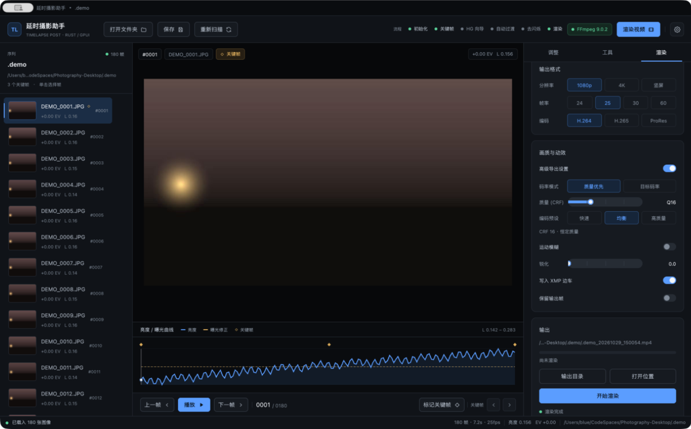
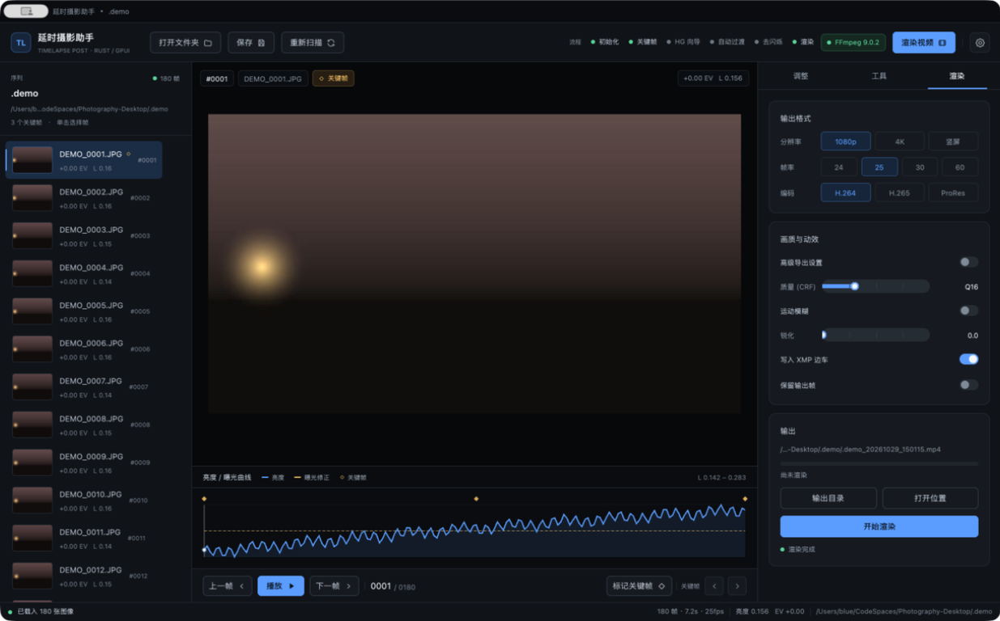
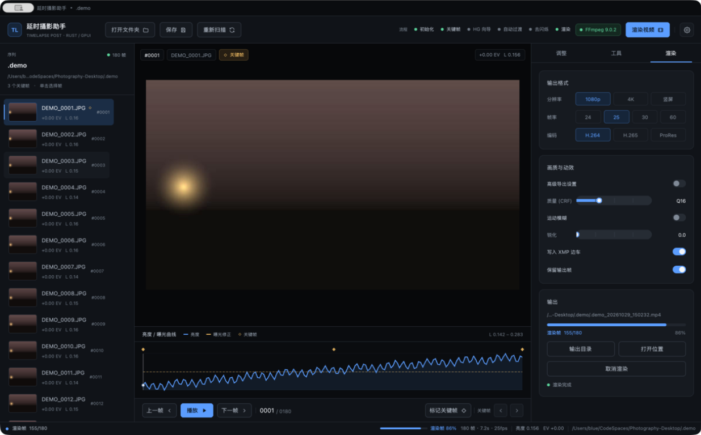
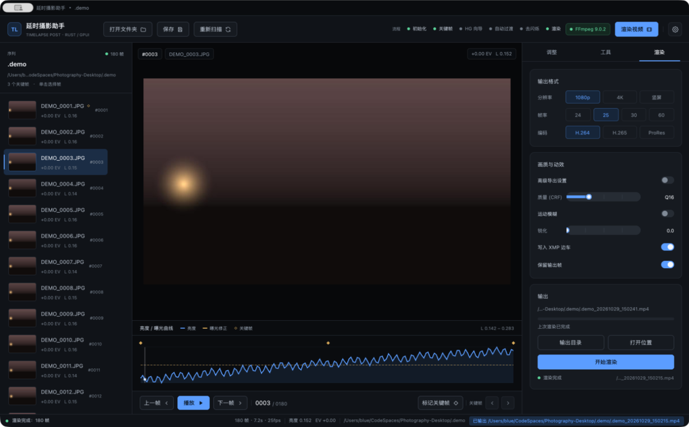

# 6. Rendering and output

**English** · [简体中文](../zh/06-rendering.md) · [Documentation home](README.md)

The **Render** tab renders the sequence to PNG frames and encodes them to video with FFmpeg. Rendering uses the latest adjustments, keyframe transition and deflicker corrections, and saves the project before starting.



## 6.1 Output format

| Setting | Options | Notes |
|---------|---------|-------|
| Resolution | 1080p (1920×1080), 4K (3840×2160), Vertical (1080×1920) | Scale to cover, then centre-crop; no stretching |
| Frame rate | 24 / 25 / 30 / 60 fps | Controls playback speed and duration |
| Codec | H.264 / H.265 / ProRes | Also selects the container: H.264 and H.265 produce `.mp4`, ProRes produces `.mov` |

### Fitting

Frames fit the canvas in **cover** mode:

1. `scale = max(target width / source width, target height / source height)`;
2. Resample to `source size × scale` with Lanczos3;
3. Centre-crop to the target width and height.

Photos with different aspect ratios are therefore never stretched, but edges beyond the target ratio are cropped. Use the same camera framing and aspect for a sequence.

## 6.2 Quality and motion

### Advanced export settings

On by default. When on, the full rate-control and encoder-preset controls are visible. When off, only the CRF quality slider remains (except for ProRes).



### Rate control

| Mode | Control | Range | Default | Notes |
|------|---------|-------|---------|-------|
| Quality first | CRF | 10 … 30 | 16 | Lower is better quality and larger files |
| Target bitrate | VBR target | 2 … 100 Mbps | 20 | Fixed delivery specification |

Target bitrate passes the following to FFmpeg:

```text
-b:v <target>M  -maxrate <target×1.25>M  -bufsize <target×2>M
```

The UI shows an estimate: `VBR target 20 Mbps · about 2.5 MB/s`.

### Encoder presets

| Preset | x264 / x265 preset | Character |
|--------|--------------------|-----------|
| Fast | `veryfast` | Fast encode, slightly lower compression |
| Balanced | `medium` | Default; speed and size in balance |
| Best | `slow` | Higher compression, longer encode |

### Codec arguments

| Codec | Key arguments |
|-------|---------------|
| H.264 | `libx264`, `yuv420p`, `+faststart`, CRF or VBR |
| H.265 | `libx265`, `yuv420p10le`, `hvc1`, CRF or VBR |
| ProRes | `prores_ks`, profile 3, `yuv422p10le`; CRF and bitrate ignored |

> ProRes uses a fixed profile quality. Selecting ProRes hides the rate-control and CRF controls and shows an explanatory note.

### Other switches

| Switch | Default | Behaviour |
|--------|---------|-----------|
| Motion blur | Off | Blends neighbouring frames; the current UI uses a 2-frame kernel; increases render time |
| Sharpen | 0.00 | Range 0 … 2.00, step 0.05, applied after scaling |
| Write XMP sidecars | On | Exports all XMP before rendering |
| Keep output frames | Off | Copies rendered PNGs to `.lrtassist/exported_frames/` |

Motion-blur weights: current frame 2, neighbours 1, with boundary frames clamped to the sequence ends.

## 6.3 Output path

### Default naming

Without a manual path:

```text
<sequence folder>/<sequence name>_YYYYMMDD_HHMMSS.<mp4|mov>
```

For example:

```text
/Volumes/SSD/sunset/sunset_20261029_150215.mp4
```

- The sequence name is the folder name;
- The timestamp is local time, to the second;
- The extension follows the codec.

### Manual selection

Click **Output folder** to choose a folder; the default filename is placed inside it. The path appears at the top of the Output card and is ellipsised in the middle when long.

**Show in folder** reveals the most recent successful output:

- macOS: selects the file in Finder;
- Windows: selects the file in Explorer;
- Other platforms: opens the containing folder.

The button does nothing if no render has completed.

## 6.4 Render pipeline

1. Check FFmpeg; if missing, open Settings and stop;
2. Save the project;
3. If **Write XMP sidecars** is on, export XMP first;
4. Clear and recreate `.lrtassist/render/frames/`;
5. Render frames in parallel with `num_cpus / 2` threads (clamped 2 … 4);
6. Write frames as `frame_000001.png` and so on;
7. Update progress every 5 frames and at completion;
8. If **Keep output frames** is on, copy to `.lrtassist/exported_frames/`;
9. Invoke FFmpeg with the arguments above;
10. Delete the intermediate frame directory unless frames are kept;
11. Set `workflow.stage = Finished` and record the output path.

### Progress and cancel



- The progress bar shows `rendered / total` and a percentage;
- The status bar mirrors it, e.g. "Rendering frames 155/180";
- The encode stage shows "Encoding video";
- **Cancel render** sets a flag: the frame stage stops after the current frame, and the encode stage kills the FFmpeg child process;
- Cancel or failure deletes the intermediate frame directory (frames already copied by "keep output frames" are not rolled back).

### Completion



When finished:

- The status bar shows "Render complete: N frames";
- A toast shows "Wrote <path>";
- The Output card shows a green "Render complete" and the latest path;
- The Render step in the top workflow strip lights up.

## 6.5 Performance and storage

| Item | Estimate |
|------|----------|
| Intermediate frames | 2–6 MB per 1080p PNG; about 0.4–1 GB for 180 frames |
| 4K intermediate frames | 8–20 MB each; reserve several GB |
| Parallelism | Half the CPU cores, at most 4 threads |
| Encoding | H.264 is fastest; H.265 is slower but smaller; ProRes is largest |
| Motion blur | Roughly doubles the rendered frames |

Intermediate frames are temporary and removed on success or cancel; enable **Keep output frames** to retain them. If disk space runs out, rendering fails while writing frames and reports the error in the status bar.

## 6.6 Render acceptance checks

- Choose 1080p / 25 fps / H.264 / CRF 16 and click **Start render**;
- Progress advances from 0 to 100% and the status bar shows frame counts;
- The output appears at the default path or the chosen folder;
- Playing it shows a duration equal to `frames ÷ fps`;
- With **Write XMP sidecars** on, `.xmp` files appear next to the photos;
- With **Keep output frames** on, `.lrtassist/exported_frames/` contains PNGs;
- Clicking **Cancel render** mid-render reports "Cancelled" and cleans intermediate frames;
- **Show in folder** reveals the output (Finder on macOS, Explorer on Windows).

---

[← Previous: Tools](05-tools.md) · [Next: Settings and FFmpeg →](07-settings-ffmpeg.md)
