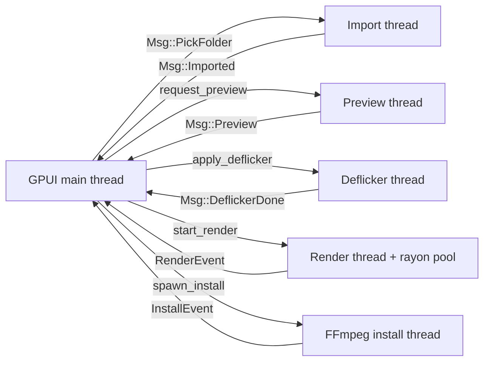
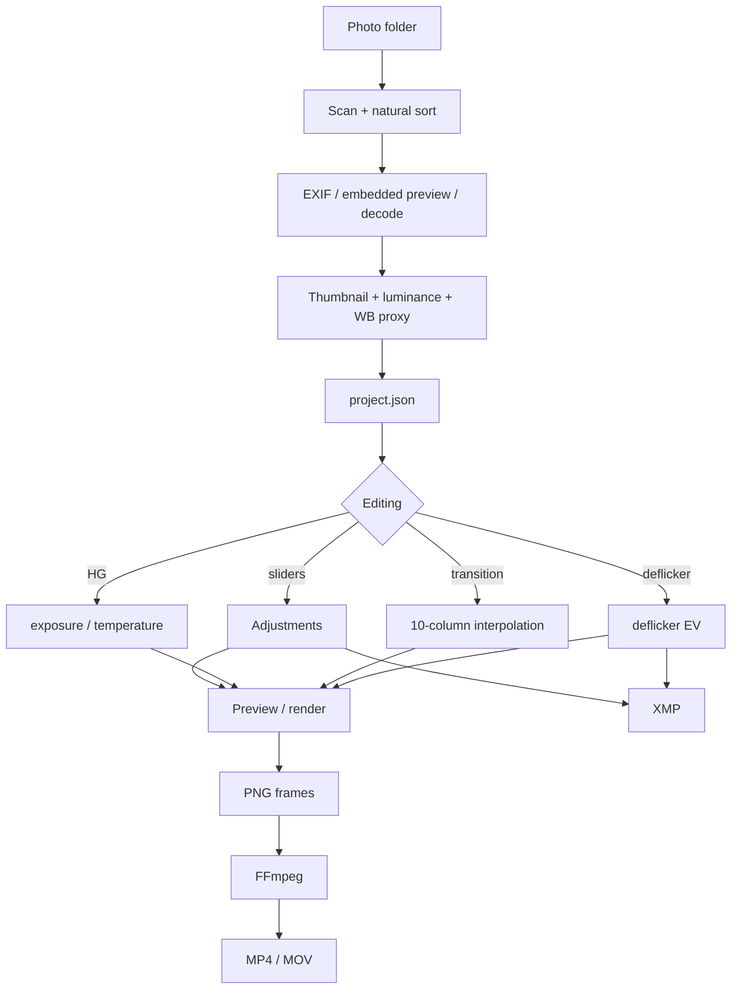

# 9. Architecture and implementation

**English** · [简体中文](../zh/09-architecture.md) · [Documentation home](README.md)

This page is for readers who want to modify the code or diagnose deeper issues. It covers module boundaries, threading, data flow and the render pipeline. The UI is an immediate-mode GPUI view; all state lives in `TimelapseApp`.


## 9.1 Stack

| Layer | Choice |
|-------|--------|
| Language | Rust 2021 |
| GUI | GPUI 0.2.2 |
| Images | `image` 0.25 (JPEG / PNG / TIFF / WebP) |
| RAW | `rawler` 0.6 (optional feature, enabled by default) |
| EXIF | `kamadak-exif` 0.6 |
| Parallelism | `rayon` |
| Serialisation | `serde` + `serde_json` |
| File dialogs | `rfd` |
| Downloads | `ureq` |
| Archives | `zip` / `flate2` / `tar` |
| Time | `chrono` |

`rawler` is a default feature. `cargo build --no-default-features` produces a build without RAW demosaicing; RAW files then use embedded previews directly.

## 9.2 Modules

```text
src/
  main.rs              # opens the GPUI window
  lib.rs               # exports core / ui
  core/
    model.rs           # Sequence, ImageEntry, Adjustments, Settings
    analysis.rs        # import, EXIF, thumbnails, luminance, visual curve
    image_pipeline.rs  # develop / ToneTable / sharpen
    holy_grail.rs      # HG curve and optimizer
    deflicker.rs       # deflicker and flicker score
    transition.rs      # keyframe interpolation
    render.rs          # frame rendering, ffmpeg encoding, output naming
    xmp.rs             # XMP sidecar read/write
    ffmpeg.rs          # component discovery, install, switch
    loess.rs           # LOESS smoothing and statistics
  ui/
    app.rs             # app state, layout, interaction
    graph.rs           # luminance / exposure graph
    icons.rs           # embedded SVG icons
  bin/
    tlcore.rs          # headless CLI
```

### State ownership

- `TimelapseApp` owns `Option<Sequence>`, the selected frame, preview image, task state, toasts and UI flags;
- `Sequence` is the only serialisable project state, saved to `project.json`;
- The UI never edits source files directly; it edits the in-memory `Sequence`;
- Background tasks send results back through `crossbeam_channel`, avoiding cross-thread borrows.

## 9.3 Threading



| Work | Runs on | Result delivery |
|------|---------|-----------------|
| Import / analysis | Dedicated thread | `Msg::Imported` with the new sequence |
| Preview render | One thread per request | `Msg::Preview { generation, index, bytes }` |
| Deflicker | Dedicated thread | `Msg::DeflickerDone { seq, before, after }` |
| Render | Dedicated thread + rayon pool | `RenderEvent` forwarded as `Msg::Render` |
| FFmpeg install | Dedicated thread | Forwarded `InstallEvent` |
| Save | UI thread (fast IO) | Direct state update |

### Preview generations

Rapid edits create several preview requests. Each request increments `preview_generation`, and only results matching the current generation and selected frame are accepted, so an old image can never overwrite a newer one.

### Render parallelism

```rust
num_threads = (num_cpus::get() / 2).clamp(2, 4)
```

Each thread independently decodes, grades, scales and sharpens, then writes its own PNG, so frames share no mutable state. Progress is tracked with `AtomicUsize`.

## 9.4 Data flow



## 9.5 Image pipeline

### Decoding

| Use | Function | Size |
|-----|----------|------|
| Thumbnail / analysis | `decode_preview` | 640 (thumbnail) / 320 (analysis) long edge |
| Interactive preview | `decode_preview` | 1400 long edge |
| Final render | `decode_full` | Source size |

RAW order:

1. Try the embedded JPEG;
2. Prefer `rawler` demosaicing;
3. Fall back to the embedded preview on failure;
4. Record `error` if both fail; that frame cannot be rendered.

### Grading

`develop()` applies, in order:

1. Exposure (total EV = `exposure + deflicker`);
2. White balance (temperature / tint);
3. Tone curve (contrast, highlights, shadows, whites, blacks);
4. Saturation / vibrance;
5. Optional sharpening (render only).

`ToneTable` precomputes a tone-mapping lookup table so pixels are not recomputed per sample.

### Scaling and cropping

`fit_to_canvas` uses cover mode: scale up by the larger ratio, then centre-crop. Resampling uses Lanczos3.

### Sharpening

`sharpen()` runs after scaling with strength 0 … 2, avoiding halos from sharpening before downscale.

## 9.6 Algorithm modules

| Module | Key functions | Notes |
|--------|---------------|-------|
| `loess.rs` | `loess` / `smooth_frames` | Locally weighted regression with proportional windows; shared by deflicker and HG |
| `holy_grail.rs` | `apply_hg` / `optimize_hg` | Exposure compensation + WB jump suppression; 352-evaluation grid search |
| `deflicker.rs` | `compute_deflicker` / `flicker_score` | Log luminance, multi-pass correction, residual standard deviation |
| `transition.rs` | `interpolate` / `interpolate_adjustments` | Single/all-column interpolation, boundary hold |
| `analysis.rs` | `import_folder` / `visual_curve_from_thumbs` | Import, cache reuse, visual curve |
| `render.rs` | `render_sequence` / `video_args` | Parallel frames, encoder arguments, output path |

Detailed formulas are in [Tools](05-tools.md).

## 9.7 FFmpeg management

`ffmpeg.rs` handles:

- Platform-specific executable names (`ffmpeg.exe` on Windows);
- Component root resolution (app directory first, user data directory fallback);
- Detecting system FFmpeg and managed versions;
- Reading and writing `versions.json`;
- Downloading, extracting, importing, switching and uninstalling;
- First-run auto-install decisions.

Windows has downloadable builds; other platforms do not auto-download and prefer the system FFmpeg.

## 9.8 Tests and verification

| Test | Location | Checks |
|------|----------|--------|
| Transition boundary hold | `transition.rs` | Hold outside keyframes; smoothstep hits endpoints |
| High-frequency removal | `deflicker.rs` | Residual drops, slow ramp preserved |
| Constant mode | `deflicker.rs` | Output brightness ratio near 1 |
| Existing exposure | `deflicker.rs` | Positive exposure yields a negative correction |
| CRF / bitrate args | `render.rs` | Correct ffmpeg flags |
| XMP fields | `xmp.rs` | Total EV, custom WB, old tags preserved |
| Encoder args | `render.rs` | H.264 / H.265 / ProRes branches |

Run:

```bash
cargo test --release
```

For an end-to-end check, use `tlcore demo` to create a synthetic sequence, then run analysis, HG, transition, deflicker, report, XMP and render in order.

## 9.9 Extension guide

| Adding | Suggested entry points |
|--------|------------------------|
| A new adjustment | `Adjustments`, `AdjustColumn`, `image_pipeline::develop`, XMP mapping |
| A new codec | `OutputCodec`, `render::video_args`, Render tab buttons |
| A new analysis metric | `ImageEntry`, `analysis::import_folder`, graph drawing |
| A new tool | New `core` module, a card in `tools_tab`, fields in `project.json` |
| A new CLI command | `match` branch in `bin/tlcore.rs` |

Keep `#[serde(default)]` when adding fields to `Sequence`, so older project files still load.

---

[← Previous: CLI and file formats](08-cli-and-files.md) · [Next: Troubleshooting →](10-troubleshooting.md)
