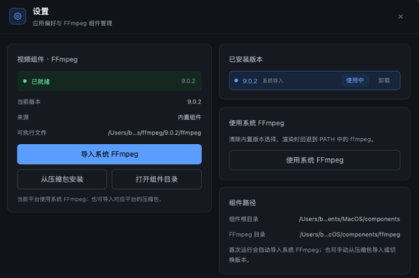

# 10. Troubleshooting

**English** · [简体中文](../zh/10-troubleshooting.md) · [Documentation home](README.md)

This page is organised by symptom, with likely causes, diagnostics and recovery steps. Start with the status bar and the FFmpeg pill; they usually identify the problem.



## 10.1 Startup and window

| Symptom | Likely cause | Fix |
|---------|--------------|-----|
| macOS does nothing on double-click or warns about verification | Gatekeeper blocks an unsigned build | Allow under **System Settings → Privacy & Security**, or rebuild locally |
| Windows reports a missing DLL | Incomplete release folder | Use the full `dist/`, or install the Visual C++ runtime |
| Window closes immediately | Panic during startup | Run the binary from a terminal and read stderr |
| Blurry UI text | Scaling or GPU driver | Use the recommended display scaling; update the GPU driver |
| Window cannot shrink below 1180×720 | Minimum size limit | Expected behaviour |

## 10.2 Import and files

### Open folder does nothing

1. Confirm the argument is a directory, not a file;
2. Confirm the first level contains supported extensions;
3. Check the status bar for an error;
4. Reproduce with `tlcore analyze <folder>` — the error includes context.

### "No images" is reported

- The folder is empty;
- Photos are only in subfolders (no recursion);
- Extensions are unsupported;
- Files are locked or inaccessible.

### Some photos show errors

A failed decode does not abort the import; the error is stored in `images[].error`. Common causes:

| Cause | Fix |
|-------|-----|
| RAW format not supported by `rawler` | Falls back to embedded preview; if that fails, export DNG/TIFF first |
| Corrupt file | Verify in another app; remove the frame if necessary |
| Unusual colour profile | Convert to sRGB JPEG and retry |
| File being written by another app | Wait, then rescan |

### Rescan does not update

If only `project.json` changed (for example keyframes edited via CLI), the UI keeps the in-memory sequence. Restart the app. If photos changed, confirm size or modification time changed; delete the corresponding thumbnail if needed.

## 10.3 Preview and graph

| Symptom | Cause | Fix |
|---------|-------|-----|
| Blank / black preview | Decode failure or extreme adjustments | Check the status bar; click **Reset** |
| Preview brightness differs from the final video | Preview is a 1400 px proxy, final uses full resolution | Trust the render; check sharpening and motion blur |
| No keyframe markers on the graph | No keyframes marked yet | Mark them in the preview or use **Mark first & last keyframes** |
| Playback stutters | Large sequence or slow disk | The app manages preview size; close other disk-heavy apps |
| Preview lags after moving a slider | Preview renders asynchronously | Expected; only the last request is kept |

## 10.4 Adjustments and keyframes

- **Clicked slider value is slightly off**: the track has 48 segments, so a click lands on a segment value; use `−` / `+` for exact steps.
- **Too many keyframes after editing**: Auto keyframe is on by default; turn it off at the top-right of the Adjust tab.
- **Deflicker survives Reset**: Reset only clears the ten creative parameters; use **Clear** on the Tools tab for deflicker.
- **Auto transition says two keyframes are required**: mark at least the first and last frames.
- **Manual edits on middle frames disappear after transition**: transition overwrites everything between keyframes; mark frames you want to keep as keyframes.

## 10.5 Holy Grail

| Symptom | Cause | Fix |
|---------|-------|-----|
| Almost no change | No EXIF and flat luminance | Confirm the camera wrote EXIF; inspect the graph |
| Too bright / too dark | Offset or stretch too large | **Reset**, then optimize again |
| White balance jumps | Gray-world proxy skewed by a large single colour | Lower stretch, or adjust temperature manually |
| Optimize is slow | Long sequence | Sequences over 600 frames are subsampled; test on a shorter clip first |
| Creative grading was overwritten | HG writes exposure/temperature/tint | Run HG before grading, or accept the overwrite and re-grade |

## 10.6 Deflicker

| Symptom | Cause | Fix |
|---------|-------|-----|
| Flicker score does not drop | Smoothing too small or accuracy too coarse | Increase smoothing, use Normal/Fine, add passes |
| Slow drift appears | Smoothing too large or Fine threshold too low | Decrease smoothing, use Normal |
| Everything darkens in constant mode | Constant mode pulls the sequence to its mean | Turn constant mode off |
| Flicker remains | It is local, not global luminance | This tool handles global luminance only |
| Runs for a long time | Multiple passes on a long sequence | Try one pass first |

Deflicker uses the thumbnail visual curve and does not analyse full-resolution local regions. Run it after HG and creative grading.

## 10.7 Rendering


### Start render does nothing

1. Check that the FFmpeg pill is green;
2. If red, Settings opens automatically — install or import FFmpeg;
3. Check whether another render is running (the button becomes **Cancel render**);
4. Check the status bar for an error.

### Render fails

| Error keyword | Cause | Fix |
|---------------|-------|-----|
| `ffmpeg not found` | Component missing or path broken | Re-import / reinstall in Settings |
| `ffmpeg failed: ...` | Encoder arguments or output path | Read stderr; try another output folder; confirm writability |
| `No space left on device` | Intermediate frames filled the disk | Clear `.lrtassist/render/frames/`; use another disk |
| `Permission denied` | Read-only folder | Choose a writable folder |
| `cancelled` | User cancelled | Normal; render again |
| Single-frame decode error | A corrupt photo | Repair or remove the frame |

### Output file cannot be found

- The default output is in the **sequence folder**, not the app folder;
- Filenames contain the sequence name and a timestamp;
- If an output folder was chosen, the path is shown at the top of the Render card;
- **Show in folder** reveals the latest successful output;
- Finder may lag on macOS; wait or refresh manually.

### Video duration is wrong

Duration = frames ÷ fps. For example, 180 frames at 25 fps = 7.2 s. If the source itself has duplicates, clean the sequence first.

### Image is cropped

The app fits in cover mode, so edges beyond the target aspect are cropped. Choose a resolution matching the footage aspect, or unify framing in another tool first.

### ProRes has no bitrate control

ProRes uses fixed profile 3 quality; CRF and target bitrate do not apply and the controls are hidden.

### Render is slow

- 4K + H.265 + Best is the slowest combination;
- Motion blur doubles decode/grade work;
- Parallelism is capped at 4 threads;
- Mechanical or network drives slow things down significantly;
- Preview with 1080p / H.264 / Fast first.

## 10.8 FFmpeg components

| Symptom | Fix |
|---------|-----|
| State stays **FFmpeg required** | Install system FFmpeg (e.g. `brew install ffmpeg`) then **Import system**, or install from an archive |
| Download stalls | Check network/proxy; use offline archive installation |
| Wrong version after import | The version is parsed from `ffmpeg -version`; make sure the correct executable was chosen |
| Switching has no effect | Restart the app; check `versions.json` and that the directory exists |
| Uninstall is unavailable | That version is active; switch to system or another version first |
| Store is not writable | The app falls back to the user data directory; or move the app somewhere writable |

Diagnose:

```bash
tlcore ffmpeg-status
```

The output lists source, version, executable path, component store and installed versions. An empty path means no usable FFmpeg was found.

## 10.9 Project files and recovery

### Project will not open

A `project.json` parse failure usually means corruption. The app reports the error without overwriting the file. Steps:

1. Back up `.lrtassist/project.json`;
2. Check that it is valid JSON (e.g. `python -m json.tool`);
3. If it cannot be repaired, delete `project.json` and re-import — adjustments and keyframes are lost, photos are not;
4. Thumbnail caches can stay and will be reused.

### `.lrtassist/` was deleted by mistake

- Original photos are unaffected;
- Adjustments, keyframes and workflow state are lost;
- Reopening the folder recreates the project and thumbnails;
- Render settings return to defaults.

### Autosave does not fire

- Saves are deferred during import / render / deflicker;
- Closing the window forces a save;
- **Save** in the top bar writes immediately;
- If saving fails, the status bar reports it, usually read-only media or no space.

## 10.10 Performance and resources

| Scenario | Advice |
|----------|--------|
| Thousands of frames | Import and deflicker are slower; process in batches |
| 4K rendering | Reserve at least 10 GB of temporary space; close other large apps |
| Low memory | Run fewer tasks at once; avoid playback during render |
| Network drive | Copy locally before processing |
| Thermal throttling | Watch cooling during render; lower the preset |

## 10.11 Collecting diagnostics

For an issue you cannot pin down, gather:

1. OS and version;
2. App version (window subtitle / build time);
3. `tlcore ffmpeg-status` output;
4. Reproduction steps and the status-bar error text;
5. The relevant fragment of `project.json` (it may contain local paths);
6. FFmpeg stderr from a failed render.

With these, most issues can be located in minutes.

---

[← Previous: Architecture and implementation](09-architecture.md) · [Back to documentation home](README.md)
