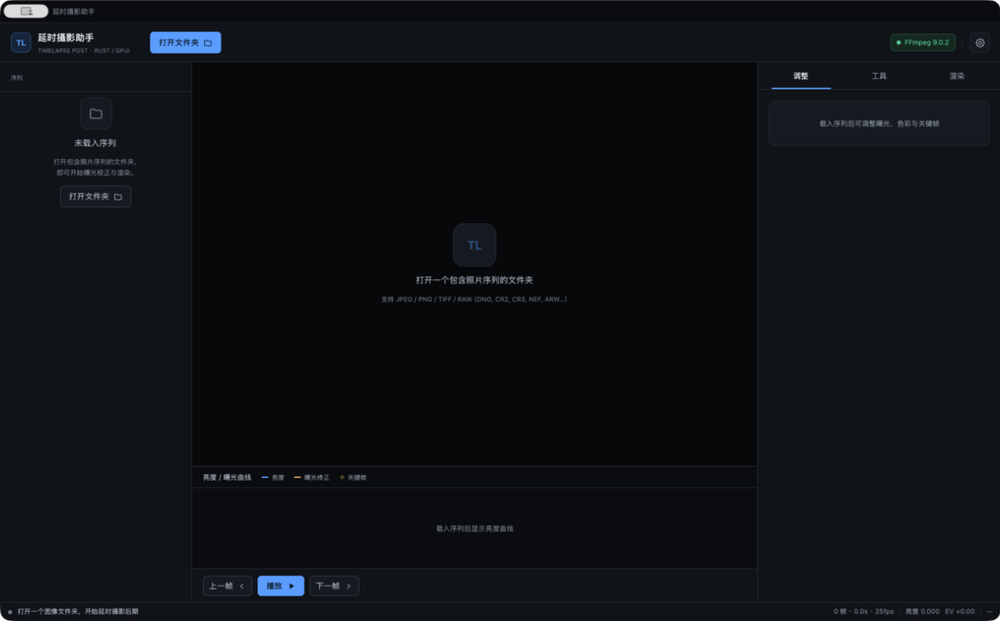

# 1. 安装与首次运行

[English](../en/01-installation.md) · [文档首页](README.md)

本篇覆盖系统要求、源码构建、启动参数、首次运行行为、支持的文件格式以及项目目录布局。完成后你应该能打开一个序列并看到缩略图与亮度曲线。



## 1.1 系统要求

| 项目 | 要求 |
|------|------|
| 操作系统 | macOS 11 及以上（Apple Silicon / Intel）；Windows 10 / 11 64 位 |
| 内存 | 建议 8 GB 以上；4K 序列与多遍去闪烁会占用更多 |
| 磁盘 | 程序约 30 MB；缩略图与渲染中间帧另计 |
| 构建工具 | Rust stable（2021 edition）与 C/C++ 链接器 |
| FFmpeg | 不要求预装。首次运行会导入系统版本或引导安装 |
| 显示 | 窗口默认 1480×920，最小 1180×720 |

> 截图中的界面为深色主题，窗口标题栏由程序自绘，仅保留系统的最小化 / 最大化 / 关闭按钮。

## 1.2 从源码构建

在仓库根目录执行：

```bash
cargo build --release
```

产物：

| 平台 | 桌面程序 | CLI |
|------|----------|-----|
| macOS | `target/release/timelapse_assistant` | `target/release/tlcore` |
| Windows | `target\release\timelapse_assistant.exe` | `target\release\tlcore.exe` |

构建时间主要花在 GPUI 与图像解码依赖上。只想验证算法时，可以用 `cargo test --release` 运行单元测试，无需打开窗口。

### macOS 应用包

仓库的 `dist/Timelapse Assistant.app` 是一个可直接运行的 bundle。更新二进制后，将新构建复制进去：

```bash
cargo build --release
cp target/release/timelapse_assistant \
   "dist/Timelapse Assistant.app/Contents/MacOS/timelapse_assistant"
open "dist/Timelapse Assistant.app"
```

如果从网络下载了未签名构建，首次打开可能被 Gatekeeper 拦截。可在「系统设置 → 隐私与安全性」中允许，或在本地重新构建。

### Windows 可执行文件

```powershell
cargo build --release
.\target\release\timelapse_assistant.exe
```

发布目录通常包含：

```text
dist/
  timelapse_assistant.exe
  tlcore.exe
  components/            # 首次运行后出现
```

## 1.3 启动参数

桌面程序接受位置参数与两个选项：

```text
timelapse_assistant [文件夹] [--tab adjust|tools|render|settings] [--frame N]
```

| 参数 | 作用 | 示例 |
|------|------|------|
| `文件夹` | 启动时立即导入该序列目录；必须是已存在的目录 | `timelapse_assistant ~/Pictures/sunset` |
| `--tab` | 打开右侧指定工作页；`settings` 会同时打开设置弹窗并停留在「调整」页 | `--tab render` |
| `--frame` | 选中第 N 帧，编号从 1 开始；越界时保持第 1 帧 | `--frame 91` |

示例：

```bash
# 打开序列并直接进入渲染页
target/release/timelapse_assistant "/Volumes/SSD/sunset" --tab render

# 打开序列并定位到中间帧
target/release/timelapse_assistant "/Volumes/SSD/sunset" --frame 91
```

不带参数启动时显示空状态，可点击「打开文件夹」选择目录。

## 1.4 首次运行与 FFmpeg

首次启动会检查 FFmpeg：

1. 先在 `PATH` 与常见安装目录（`/opt/homebrew/bin`、`/usr/local/bin`、`/usr/bin`）中查找；
2. 找到系统 FFmpeg 时导入到组件目录并选中（所有平台都会复制可执行文件）；
3. 都没有时：Windows 先尝试镜像快速安装，失败后回退官方源；macOS 不自动下载，会提示在设置中导入。

顶部栏右侧的 FFmpeg 状态胶囊会显示「FFmpeg <版本>」「FFmpeg 系统」或「需要 FFmpeg」。点击胶囊即可打开设置弹窗；详细流程见 [设置与 FFmpeg 组件](07-settings-ffmpeg.md)。


> 即使 FFmpeg 未就绪，仍可导入序列、调色、运行 HG/过渡/去闪烁并导出 XMP。只有「开始渲染」会被阻止，并自动打开设置。

## 1.5 支持的文件格式

| 类别 | 扩展名 | 说明 |
|------|--------|------|
| 常规图像 | `.jpg` `.jpeg` `.png` `.tif` `.tiff` | 直接解码 |
| 相机 RAW | `.dng` `.cr2` `.cr3` `.nef` `.arw` `.raf` `.orf` `.rw2` `.srw` `.pef` | 优先 `rawler` 去马赛克，失败回退内嵌预览 |

导入时的行为：

- 只扫描所选目录的第一层，不递归子目录；
- 扩展名大小写不敏感；
- 按文件名自然排序（`IMG_2` 排在 `IMG_10` 前）；如序列中带拍摄时间，可在项目中切换为按时间排序；
- 每个文件生成最长边 640 px 的缩略图，分析使用最长边 320 px 的预览；
- 单张解码失败不会中断导入，错误会记录在该帧条目上并显示在列表中。

## 1.6 项目目录

导入后会在序列文件夹下创建：

```text
<序列文件夹>/
  IMG_0001.JPG
  IMG_0002.JPG
  ...
  .lrtassist/
    project.json          # 序列元数据、调整、关键帧、设置、工作流状态
    thumbs/               # 缩略图缓存
    render/frames/        # 渲染时的中间帧（完成或取消后删除）
    exported_frames/      # 勾选「保留输出帧」时的成片帧
```

- `project.json` 采用「写入临时文件再重命名」的原子保存，避免中断导致文件损坏；
- 再次打开同一目录会复用缩略图；仅当文件大小或修改时间变化时才重新生成；
- 删除 `.lrtassist/` 会清空所有调整、关键帧与缓存，但不会删除原始照片；
- 移动或备份序列时，建议连同 `.lrtassist/` 一起移动，以保留工作状态。

## 1.7 首次运行验收清单

完成以下检查即可确认安装正常：

1. 启动后能看到空状态卡片与顶部「打开文件夹」按钮；
2. 打开一个包含至少 10 张 JPEG 的目录，左侧出现缩略图列表；
3. 中央显示当前帧，下方出现亮度 / 曝光曲线；
4. 顶部 FFmpeg 胶囊为绿色（「FFmpeg 系统」或带版本号）；
5. 点击右侧「调整」页任意滑块，状态栏 EV 数值发生变化；
6. 关闭程序后重新打开同一目录，调整与关键帧仍然存在。

---

[← 文档首页](README.md) · [下一篇：界面总览 →](02-interface.md)
