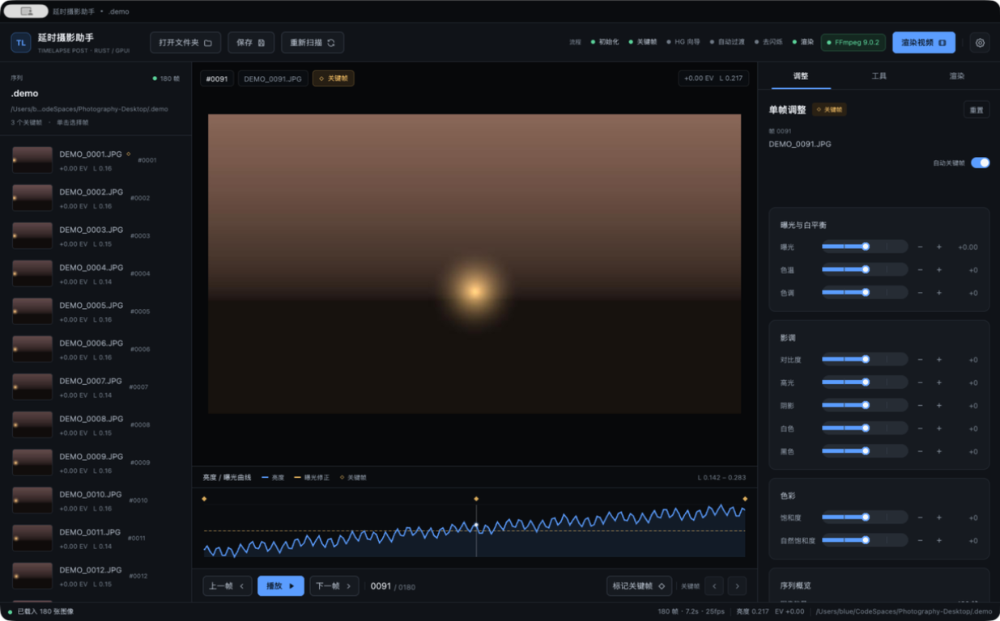
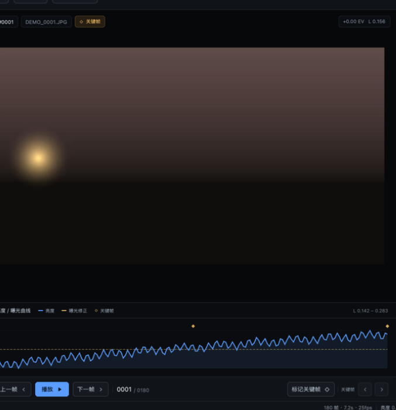

# 2. 界面总览

[English](../en/02-interface.md) · [文档首页](README.md)

界面是一块固定的五区布局：自绘标题栏、顶部工具栏、左侧序列列表、中央预览与曲线、右侧工作页，以及底部状态栏。设置不占用右侧工作页，而是从顶部右侧齿轮打开的模态弹窗。

## 2.1 窗口分区

| 区域 | 尺寸 | 作用 |
|------|------|------|
| 标题栏 | 高 34 px | 拖动窗口；系统关闭 / 最小化 / 最大化按钮 |
| 顶部工具栏 | 高 58 px | 打开、保存、重扫、流程状态、FFmpeg、渲染、设置 |
| 左侧序列列表 | 宽 284 px | 浏览与选择帧，查看 EV 与亮度 |
| 中央预览 | 自适应 | 画面预览、播放控制、亮度 / 曝光曲线 |
| 右侧工作页 | 宽 360 px | 调整、工具、渲染三个标签页 |
| 状态栏 | 高 28 px | 当前操作、进度、帧数、FPS、亮度、EV、路径、提示 |

窗口默认 1480×920，最小 1180×720。缩放到最小尺寸时，中央预览会压缩，左右面板保持固定宽度。

## 2.2 顶部工具栏

从左到右：

| 控件 | 行为 |
|------|------|
| `TL` 标识与副标题 | 仅装饰 |
| 打开文件夹 | 弹出目录选择器并导入序列 |
| 保存 | 立即写入 `project.json`（平时 2 秒防抖自动保存） |
| 重新扫描 | 重新导入当前目录；文件名、亮度与缩略图会更新 |
| 流程指示 | 初始化 → 关键帧 → HG 向导 → 自动过渡 → 去闪烁 → 渲染，已完成步骤高亮 |
| FFmpeg 状态胶囊 | 显示来源/版本；点击打开设置弹窗 |
| 渲染视频 | 等同于渲染页的「开始渲染」，会先检查 FFmpeg |
| 齿轮 | 打开 / 关闭设置弹窗 |

「保存」「重新扫描」「渲染视频」和流程指示只在载入序列后出现。未载入序列时，顶部只保留打开文件夹、FFmpeg 状态与齿轮。

> 流程指示是只读状态，不会自动跳转页面。它反映项目文件中的 `workflow` 字段，重开项目后仍会保留。

## 2.3 左侧序列列表

- 标题区显示「序列」、总帧数与关键帧数量，并提示「单击选择帧」。
- 每一行包含序号（`#0001`）、缩略图、文件名、曝光修正（`+0.35 EV`）与平均亮度（`L 0.482`）。
- 当前选中行使用强调色描边；关键帧带黄色标记。
- 单击任意行即切换当前帧。切换只改变选中项，不会自动播放。
- 列表可滚动；导入后停留在第 1 帧，若通过 `--frame N` 启动则定位到指定帧。
- 空状态会显示「未载入序列」卡片和「打开文件夹」按钮。

## 2.4 中央预览

预览区在序列载入后显示当前帧的**调色后**画面。顶部信息条包含帧号、关键帧徽标、总 EV 与亮度。

### 播放控制

| 控件 | 行为 |
|------|------|
| 上一帧 / 下一帧 | 逐帧移动；到达首/尾后不循环 |
| 播放 / 暂停 | 按渲染设置的 FPS 顺序播放；到末尾自动回到第 1 帧 |
| 帧号 | `当前帧 / 总帧数`，均从 1 开始 |
| 标记关键帧 | 切换当前帧的关键帧状态，状态栏给出「已标记关键帧 / 已取消关键帧」 |
| 上一关键帧 / 下一关键帧 | 跳到相邻关键帧；没有时保持原位 |

播放只是预览，不会写入项目；停止后当前帧保持为停止位置。

### 亮度 / 曝光曲线

曲线区绘制两条序列：

- **亮度**：导入时分析的每帧平均亮度；
- **曝光修正**：每帧的总 EV（创意曝光 + 去闪烁修正）；
- **关键帧**：在曲线上以竖直标记显示关键帧位置。

顶部显示亮度范围 `L min – max`。曲线用于判断日转夜趋势、曝光跳变与去闪烁效果；它不响应鼠标点击，帧选择请在左侧列表或播放控制中完成。

## 2.5 右侧工作页

右侧有「调整」「工具」「渲染」三个标签。标签只切换内容，不改变当前帧或项目状态。

### 调整页

- 标题「单帧调整」，当前帧为关键帧时显示黄色徽标；
- 「重置」把当前帧的全部调整恢复默认值；
- 显示帧号与文件名，右侧是「自动关键帧」开关；
- 三张参数卡：曝光与白平衡、影调、色彩；
- 底部「序列概览」汇总帧数、关键帧、时长、平均亮度、去闪烁前后、输出规格与 FFmpeg 状态。

参数范围与行为见 [单帧调整](04-adjustments.md)。

### 工具页

包含 Holy Grail 向导、关键帧自动过渡、视觉去闪烁三张卡片，以及「导出 XMP 边车」按钮。详见 [工具](05-tools.md)。

### 渲染页

包含输出格式、画质与动效、输出三张卡片。未找到 FFmpeg 时顶部会多出一张提示卡与「前往设置」按钮。详见 [渲染与输出](06-rendering.md)。

## 2.6 状态栏

状态栏从左到右：

1. 状态圆点：载入后为绿色，忙碌 / 渲染时为强调蓝色；
2. 当前操作文本，例如「就绪」「正在渲染 155/180」「渲染完成：180 帧」；
3. 渲染或分析进度条与百分比（仅进行中显示）；
4. `帧数 · 时长 · fps`；
5. `亮度 0.xxx` 与 `EV +0.00`；
6. 序列文件夹路径；
7. 临时提示（如「导出了 180 个 XMP」），4 秒后自动消失。

## 2.7 设置弹窗

- 由顶部齿轮或 FFmpeg 状态胶囊打开；
- 712 px 宽的居中模态，背景压暗；
- 左侧主卡为 FFmpeg 组件管理，右侧为版本、路径与操作说明卡；
- 点击右上角关闭按钮或弹窗外的遮罩即可关闭；
- 弹窗打开时仍可看到背后的界面，但点击会被遮罩拦截，避免误操作。

设置只包含应用级偏好（目前是 FFmpeg），与单帧调整、渲染参数分开，避免和图像操作混在一起。详见 [设置与 FFmpeg 组件](07-settings-ffmpeg.md)。

## 2.8 交互约定

- 没有全局键盘快捷键。所有功能通过鼠标点击完成。
- 滑块采用「点击轨道跳转」与「± 步进按钮」两种方式，不依赖拖动，触控板与鼠标行为一致。
- 数值显示遵循：曝光 `+0.35 EV`、亮度 `0.482`、色温等单位 `+12`。
- 任何修改都会标记项目为脏，2 秒后自动保存；关闭窗口时也会保存。
- 当一个耗时任务正在运行（导入、去闪烁、渲染、FFmpeg 安装）时，状态栏圆点变为蓝色，部分按钮会被禁用或忽略重复点击。

---

[← 上一篇：安装与首次运行](01-installation.md) · [下一篇：序列与关键帧 →](03-sequences-and-keyframes.md)
