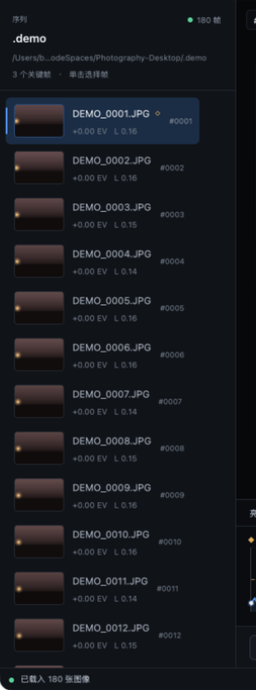

# 3. 序列与关键帧

[English](../en/03-sequences-and-keyframes.md) · [文档首页](README.md)

序列是程序的基本工作单位：一个文件夹、一组按顺序排列的照片，以及保存在 `.lrtassist/project.json` 中的分析结果、调整和关键帧。关键帧则是曝光与色彩过渡的锚点。



## 3.1 导入序列

### 入口

- 顶部「打开文件夹」；
- 空状态卡片中的「打开文件夹」；
- 启动参数传入目录；
- 顶部「重新扫描」重新导入当前目录。

### 扫描规则

| 规则 | 行为 |
|------|------|
| 目录层级 | 只扫描第一层，不递归 |
| 扩展名 | 见下表，大小写不敏感 |
| 排序 | 默认按文件名自然排序；数字段按数值比较 |
| 排除 | 隐藏文件、`.lrtassist/` 内部文件、非图像扩展名 |
| 空目录 | 报错并保持当前序列不变 |
| 非目录 | 忽略该参数 |

支持的扩展名：`jpg` `jpeg` `png` `tif` `tiff` `dng` `cr2` `cr3` `nef` `arw` `raf` `orf` `rw2` `srw` `pef`。

### 每帧分析内容

| 字段 | 来源 | 用途 |
|------|------|------|
| 文件名 / 大小 / 修改时间 | 文件系统 | 缓存失效判断 |
| 拍摄时间 | EXIF `DateTimeOriginal` | 按时间排序、时长参考 |
| ISO / 快门 / 光圈 | EXIF | 计算相机 EV，供 HG 使用 |
| 相机 EV | `log2(N²/t) − log2(ISO/100) + 曝光补偿` | HG 曝光趋势 |
| 平均亮度 | 320 px 预览的 sRGB 相对亮度 | 曲线、去闪烁、状态栏 |
| 白平衡代理 | 灰世界 R/G/B 比值的对数 | HG 白平衡补偿 |
| 缩略图 | 最长边 640 px JPEG | 左侧列表 |
| 错误 | 解码失败信息 | 列表标记与排查 |

### 缓存与重扫

缩略图保存在 `.lrtassist/thumbs/`。重新扫描时，如果文件大小与修改时间都没变且缩略图存在，则直接复用，不重新解码。以下情况会触发重新分析：

- 文件被替换或重新导出；
- 文件大小或修改时间变化；
- 缩略图被删除；
- 项目文件中的条目与磁盘不一致。

> 已知限制：如果只修改了 `project.json`（例如用 `tlcore keyframes` 改了关键帧），再点「重新扫描」不会重新读取该文件，因为程序以内存中的序列为准。此时请重启程序，或在界面中重新标记。

## 3.2 选择与播放

- 单击左侧任意行选择该帧；当前帧在预览区、调整页、状态栏同步更新。
- 上一帧 / 下一帧逐帧移动，不循环。
- 播放按渲染设置中的 FPS 推进；到达末帧后回到首帧继续。
- 播放期间可以继续选择其他帧，播放会从新位置继续。
- 预览使用调色后的缩略图/预览尺寸，不代表最终渲染分辨率。

## 3.3 关键帧语义

关键帧是「自动过渡」的锚点：两个关键帧之间的所有帧，其调整值由插值决定；最外侧关键帧之外的帧保持最近关键帧的值。

| 操作 | 入口 | 结果 |
|------|------|------|
| 标记 / 取消 | 预览区「标记关键帧」按钮 | 切换当前帧状态，状态栏提示 |
| 首尾关键帧 | 工具页 HG 卡片「标记首尾关键帧」 | 第 1 帧与最后 1 帧设为关键帧 |
| 上一 / 下一关键帧 | 预览区两个箭头按钮 | 跳到相邻关键帧，不循环 |
| 自动关键帧 | 调整页开关（默认开） | 修改任意滑块时自动把当前帧设为关键帧 |

### 关键帧与插值

- 只有 1 个关键帧时，「应用自动过渡」会把该关键帧的值复制到所有帧；
- 0 个关键帧时，界面会提示「至少需要两个关键帧」，不做任何修改；
- 关键帧本身的值不会被插值覆盖，始终精确保留；
- 最外侧关键帧之前和之后的帧保持边界值（hold），不会外推；
- 平滑模式使用 `u²(3−2u)` 的 smoothstep，在关键帧处斜率为 0，避免过渡起止出现折角；
- 线性模式直接按 `u` 插值。

### 推荐的关键帧布置

| 场景 | 建议 |
|------|------|
| 日转夜 | 首帧、曝光开始明显变化的转折点、末帧 |
| 固定机位闪烁 | 不需要很多关键帧；去闪烁独立工作 |
| 多段曝光调整 | 每个曝光台阶的起止各放一个关键帧 |
| 创意调色 | 至少首尾两个关键帧，中间可加风格切换点 |

关键帧数量会显示在顶部流程、左侧标题、工具页 HG 卡片与「序列概览」中。

## 3.4 自动保存与项目管理

| 触发 | 行为 |
|------|------|
| 任意修改 | 标记为脏，2 秒无新修改后保存 |
| 正在导入 / 渲染 / 去闪烁 | 延后保存，任务结束后再写 |
| 点击「保存」 | 立即保存 |
| 关闭窗口 | 保存后退出 |
| 渲染开始前 | 强制保存一次，确保渲染使用最新参数 |

保存采用原子写入：

1. 序列化到 `project.json.tmp`；
2. 写入完成后重命名为 `project.json`；
3. 失败时保留旧文件并返回错误。

`project.json` 包含：

```text
folder / name / images[] / settings / workflow / render / sort_by_time / hdr / saved_at
```

完整字段说明见 [命令行与文件格式](08-cli-and-files.md)。

## 3.5 常见状态

| 状态 | 含义 | 下一步 |
|------|------|--------|
| 空状态 | 尚未导入任何序列 | 打开文件夹 |
| 已载入、无关键帧 | 只有分析和缩略图 | 标记关键帧或直接调色 |
| 关键帧 = 1 | 过渡会广播单帧值 | 增加首尾关键帧 |
| 关键帧 ≥ 2 | 可运行自动过渡 | 工具页应用过渡 |
| 去闪烁已应用 | 每帧有非零 `deflicker` EV | 可在调整页查看总 EV |
| 渲染完成 | `workflow.stage = Finished` | 在渲染页「打开位置」 |

---

[← 上一篇：界面总览](02-interface.md) · [下一篇：单帧调整 →](04-adjustments.md)
