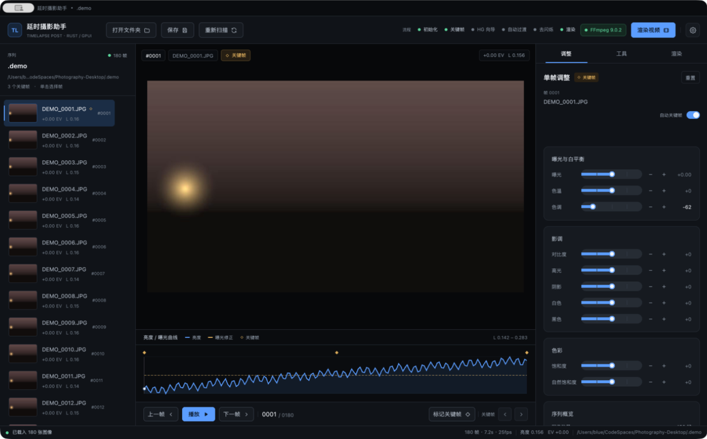
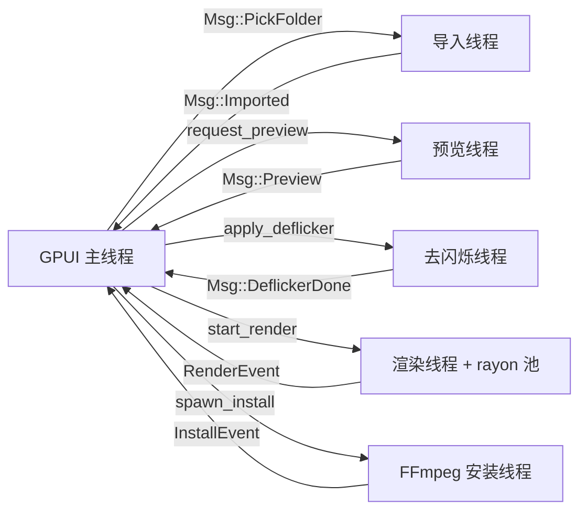
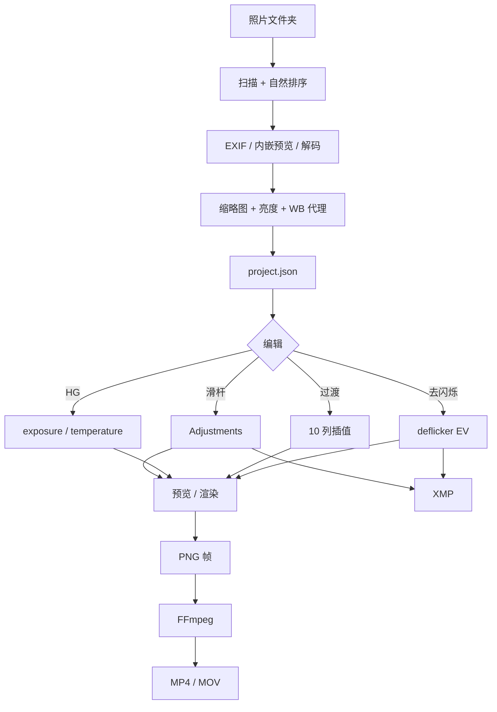

# 9. 架构与实现

[English](../en/09-architecture.md) · [文档首页](README.md)

本篇面向想修改代码或排查深层问题的读者，说明模块边界、线程模型、数据流与渲染管线。界面本身是 GPUI 的即时模式视图，所有状态集中在 `TimelapseApp`。



## 9.1 技术栈

| 层 | 选型 |
|----|------|
| 语言 | Rust 2021 |
| GUI | GPUI 0.2.2 |
| 图像 | `image` 0.25（JPEG / PNG / TIFF / WebP） |
| RAW | `rawler` 0.6（可选 feature，默认启用） |
| EXIF | `kamadak-exif` 0.6 |
| 并行 | `rayon` |
| 序列化 | `serde` + `serde_json` |
| 文件对话框 | `rfd` |
| 网络下载 | `ureq` |
| 压缩包 | `zip` / `flate2` / `tar` |
| 时间 | `chrono` |

`rawler` 是默认 feature；执行 `cargo build --no-default-features` 可得到不含 RAW 解码的构建，RAW 会直接使用内嵌预览。

## 9.2 模块划分

```text
src/
  main.rs              # 打开 GPUI 窗口
  lib.rs               # 导出 core / ui
  core/
    model.rs           # Sequence、ImageEntry、Adjustments、Settings
    analysis.rs        # 导入、EXIF、缩略图、亮度、视觉曲线
    image_pipeline.rs  # develop / ToneTable / sharpen
    holy_grail.rs      # HG 曲线与优化
    deflicker.rs       # 去闪烁与闪烁指数
    transition.rs      # 关键帧插值
    render.rs          # 帧渲染、ffmpeg 编码、输出命名
    xmp.rs             # XMP 边车读写
    ffmpeg.rs          # 组件发现、安装、切换
    loess.rs           # LOESS 平滑与统计工具
  ui/
    app.rs             # 应用状态、布局、交互
    graph.rs           # 亮度 / 曝光曲线绘制
    icons.rs           # 内嵌 SVG 图标
  bin/
    tlcore.rs          # 无界面 CLI
```

### 状态所有权

- `TimelapseApp` 持有 `Option<Sequence>`、当前选中帧、预览图、任务状态、提示与 UI 开关；
- `Sequence` 是唯一可序列化的项目状态，保存到 `project.json`；
- UI 不直接改原始文件，只改内存中的 `Sequence`；
- 后台任务通过 `crossbeam_channel` 把结果发回 UI，避免跨线程借用。

## 9.3 线程模型



| 工作 | 执行位置 | 结果回传 |
|------|----------|----------|
| 导入 / 分析 | 单独线程 | `Msg::Imported`，包含新序列 |
| 预览渲染 | 每次请求一个线程 | `Msg::Preview { generation, index, bytes }` |
| 去闪烁 | 单独线程 | `Msg::DeflickerDone { seq, before, after }` |
| 渲染 | 单独线程 + rayon 池 | `RenderEvent` 转发为 `Msg::Render` |
| FFmpeg 安装 | 单独线程 | `InstallEvent` 转发 |
| 保存 | UI 线程（快速 IO） | 直接更新状态 |

### 预览代际

快速连续调整会产生多个预览请求。每次请求递增 `preview_generation`，只有与当前代际和当前帧都匹配的结果才会被接收，避免旧画面覆盖新画面。

### 渲染并行度

```rust
num_threads = (num_cpus::get() / 2).clamp(2, 4)
```

每个线程独立解码、调色、缩放、锐化，并写自己的 PNG 文件，因此帧之间没有共享可变状态。进度用 `AtomicUsize` 统计。

## 9.4 数据流



## 9.5 图像管线

### 解码

| 场景 | 函数 | 尺寸 |
|------|------|------|
| 缩略图 / 分析 | `decode_preview` | 最长边 640（缩略图）/ 320（分析） |
| 交互预览 | `decode_preview` | 最长边 1400 |
| 最终渲染 | `decode_full` | 原始尺寸 |

RAW 处理顺序：

1. 尝试提取内嵌 JPEG；
2. 优先用 `rawler` 去马赛克；
3. 失败时回退内嵌预览；
4. 都失败则记录 `error`，该帧不参与渲染（渲染时报错）。

### 调色

`develop()` 按以下顺序应用：

1. 曝光（`exposure + deflicker` 的总 EV）；
2. 白平衡（色温 / 色调）；
3. 影调曲线（对比度、高光、阴影、白色、黑色）；
4. 饱和度 / 自然饱和度；
5. 可选的锐化（仅渲染）。

`ToneTable` 预计算色调映射查找表，避免逐像素重复计算。

### 缩放与裁切

`fit_to_canvas` 使用 cover 模式：先按最大比例放大，再居中裁切。重采样使用 Lanczos3。

### 锐化

`sharpen()` 在缩放之后执行，强度 0 … 2，避免先锐化再缩放造成光晕。

## 9.6 算法模块

| 模块 | 关键函数 | 说明 |
|------|----------|------|
| `loess.rs` | `loess` / `smooth_frames` | 局部加权回归，窗口按比例；去闪烁与 HG 共用 |
| `holy_grail.rs` | `apply_hg` / `optimize_hg` | 曝光补偿 + 白平衡跳变抑制；352 次网格搜索 |
| `deflicker.rs` | `compute_deflicker` / `flicker_score` | 对数亮度、多遍修正、残差标准差 |
| `transition.rs` | `interpolate` / `interpolate_adjustments` | 单列/全列插值，边界保持 |
| `analysis.rs` | `import_folder` / `visual_curve_from_thumbs` | 导入、缓存复用、视觉曲线 |
| `render.rs` | `render_sequence` / `video_args` | 并行帧、编码参数、输出路径 |

更细的公式见 [工具](05-tools.md)。

## 9.7 FFmpeg 管理

`ffmpeg.rs` 负责：

- 平台相关可执行文件名（Windows 为 `ffmpeg.exe`）；
- 组件根目录解析（程序目录优先，不可写时回退用户数据目录）；
- 探测系统 FFmpeg 与内置版本；
- `versions.json` 读写；
- 下载、解压、导入、切换、卸载；
- 首次自动安装决策。

Windows 有可下载构建；非 Windows 平台不自动下载，优先使用系统 FFmpeg。

## 9.8 测试与验证

| 测试 | 位置 | 验证点 |
|------|------|--------|
| 过渡边界保持 | `transition.rs` | 关键帧外 hold，smoothstep 命中端点 |
| 去闪烁去高频 | `deflicker.rs` | 残差下降、慢速斜坡保留 |
| 恒定模式 | `deflicker.rs` | 输出亮度比接近 1 |
| 已有曝光叠加 | `deflicker.rs` | 正曝光产生负修正 |
| CRF / 码率参数 | `render.rs` | ffmpeg 参数包含正确标志 |
| XMP 字段 | `xmp.rs` | 总 EV、自定义白平衡、保留旧标签 |
| 编码参数 | `render.rs` | H.264 / H.265 / ProRes 分支 |

运行：

```bash
cargo test --release
```

端到端验证可使用 `tlcore demo` 生成合成序列，再依次执行分析、HG、过渡、去闪烁、报告、XMP 与渲染。

## 9.9 扩展指引

| 想加的功能 | 建议入口 |
|------------|----------|
| 新调整参数 | `Adjustments`、`AdjustColumn`、`image_pipeline::develop`、XMP 映射 |
| 新编码格式 | `OutputCodec`、`render::video_args`、渲染页按钮 |
| 新分析指标 | `ImageEntry`、`analysis::import_folder`、曲线绘制 |
| 新工具 | 在 `core` 加模块，在 `tools_tab` 加卡片，在 `project.json` 加设置 |
| 新 CLI 命令 | `bin/tlcore.rs` 的 `match` 分支 |

修改 `Sequence` 的字段时请保留 `#[serde(default)]`，确保旧项目文件仍能打开。

---

[← 上一篇：命令行与文件格式](08-cli-and-files.md) · [下一篇：故障排查 →](10-troubleshooting.md)
